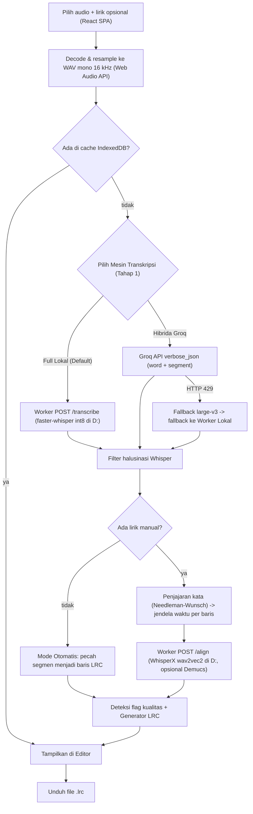

# PRD SyncLRC v3.1: WhisperX Lokal (+ Opsi Akselerasi Groq) & React SPA

17 Okt 2026 · @Andika Palian · menggantikan PRD v3.0, draf "Groq + WhisperX", dan PRD v2.0

---

## 0. Jawaban Arsitektur: Kalau Pakai WhisperX Lokal, Apakah Masih Pakai Groq?

Di dalam **WhisperX**, proses pembuatan lirik ber-timestamp sebenarnya terdiri dari **2 tahap terpisah** yang memakai **2 model berbeda**:

1. **Tahap 1 — Transkripsi Kasar (ASR / Model Whisper)**
   Mengubah audio menjadi teks dan jendela waktu kasar per segmen/kalimat.
2. **Tahap 2 — Penyelarasan Per Kata (Forced Alignment / Model Phoneme `wav2vec2`)**
   Memotong audio per baris berdasarkan jendela waktu Tahap 1, lalu mencocokkan lirik ke gelombang suara kata demi kata (`cahya/wav2vec2-large-xlsr-indonesian`).

**Implikasinya:**
- **Tahap 2 (`wav2vec2` Forced Alignment)** **tidak ada di Groq**, sehingga **wajib jalan di WhisperX lokal**.
- **Tahap 1 (Transkripsi Whisper)** bisa dijalankan dengan **dua cara** (keduanya didukung di SyncLRC v3.1 dan bisa dipilih di UI):

| Mode | Tahap 1 (Transkripsi) | Tahap 2 (Alignment Kata) | Ukuran Model Lokal di `D:` | Kecepatan di CPU Laptop (lagu 4 mnt) | Butuh Internet / API Key? |
|---|---|---|---|---|---|
| **1. Full Lokal (Default pilihanmu)** | `faster-whisper` lokal (`small` / `large-v3-turbo` int8) | `whisperx.align` lokal (`wav2vec2`) | ±1,7 – 2,8 GB (Whisper + wav2vec2) | ±1,5 – 4 menit | **Tidak** (100% offline setelah model terunduh) |
| **2. Hibrida Cepat (Groq + WhisperX Lokal)** | **Groq Cloud** (`whisper-large-v3-turbo`) | `whisperx.align` lokal (`wav2vec2`) | ±1,2 GB (hanya wav2vec2) | ±20 – 45 detik (transkripsi hanya ~2 dtk) | Ya, butuh `GROQ_API_KEY` (gratis ±127 lagu/hari) |

> [!TIP]
> **Kapan tetap ada gunanya Groq walaupun WhisperX sudah diinstal lokal?**
> 1. **Lagu bahasa daerah dengan lirik manual:** kita hanya butuh jangkar waktu kasar per baris sebelum di-align oleh `wav2vec2`. Memakai Groq menghemat waktu tunggu CPU beberapa menit dan menghemat ±1,6 GB ruang disk karena tidak perlu mengunduh model Whisper `large-v3-turbo` di lokal.
> 2. **Kalau tidak mau bergantung pada akun/kuota Groq:** kamu cukup memilih **Mode Full Lokal**, maka seluruh proses (transkripsi + forced alignment) berjalan 100% di `.venv` lokal pada drive `D:`.

---

## 1. Catatan Revisi dari Draf Awal

| # | Masalah di draf awal | Dampak | Perbaikan di v3.1 |
|---|---|---|---|
| 1 | Kesan bahwa Groq bisa menjalankan WhisperX di cloud | Salah paham arsitektur | Dijelaskan pemisahan Tahap 1 (Whisper ASR: bisa Lokal `faster-whisper` atau Groq Cloud) dan Tahap 2 (WhisperX `wav2vec2`: wajib di Worker Lokal). |
| 2 | Stack Next.js + Prisma/SQLite + fluent-ffmpeg | Berat, butuh server Node dan FFmpeg | **React SPA (Vite + TypeScript)**. Tanpa server Node, tanpa DB SQLite, tanpa FFmpeg. Cache menggunakan IndexedDB browser. |
| 3 | Instalasi Python, cache `pip`, dan unduhan model HuggingFace/PyTorch/NLTK default masuk ke `C:\Users\ASUS\...` | **Gagal instalasi karena drive `C:` hanya sisa 1,9 GB** | **Aturan NFR-01 (Zero Drive C Footprint)**: `.venv` berada di `D:\synclyrc\worker\.venv`, dan seluruh variabel cache (`PIP_CACHE_DIR`, `HF_HOME`, `TORCH_HOME`, `NLTK_DATA`, `TEMP`, `TMP`, `npm_config_cache`) wajib diarahkan ke `D:\synclyrc\`. |
| 4 | `pip install whisperx` penuh menarik `pyannote-audio` & `torchcodec` | Membutuhkan FFmpeg DLL sistem & token HF, menambah ratusan MB | Menginstal paket inti yang dibutuhkan (`torch` CPU, `torchaudio`, `transformers`, `faster-whisper`, `nltk`, `soundfile`) + `whisperx --no-deps` karena `whisperx` memakai *lazy import*. |
| 5 | FR-02: konversi FLAC lewat FFmpeg | Butuh biner FFmpeg | Browser men-decode audio (Web Audio API) dan me-resample ke **WAV mono 16 kHz** yang langsung bisa dibaca `soundfile` di worker lokal maupun dikirim ke Groq. |
| 6 | FR-06 mencocokkan baris lirik ke **segmen** | Segmen Whisper sering menggabung 2–3 baris atau memotong baris | Pencocokan di tingkat **kata** dengan penjajaran global (Needleman–Wunsch) antara token lirik dan token transkripsi; baris tanpa kecocokan diinterpolasi. |
| 7 | Prompt diisi seluruh lirik | Batas 224 token; lirik panjang terpotong & memicu halusinasi | `initial_prompt` / `prompt` hanya berisi **daftar kata unik** dari lirik (≤ 200 token). |
| 8 | Tidak ada penanganan halusinasi Whisper | Pada intro/interlude panjang, Whisper sering mengarang teks | Filter segmen dengan `no_speech_prob` tinggi + `avg_logprob` rendah serta daftar kalimat halusinasi umum. |
| 9 | Aturan jeda instrumental tidak punya angka ambang | Tidak deterministik | Baris kosong `[mm:ss.xx]` ditulis bila jeda ke baris berikutnya ≥ **3,0 detik**. |
| 10 | Gerbang prototipe mencampur kualitas model `wav2vec2` dan kualitas jendela waktu | Sulit mendiagnosis jika meleset | Evaluasi dipisah menjadi: (A) `wav2vec2` dengan jendela dari LRC referensi, (B) transkripsi saja + pencocokan teks, (C) transkripsi + `wav2vec2` tanpa Demucs, (D) dengan Demucs. |

---

## 2. Sasaran dan di Luar Cakupan

**Sasaran MVP**
- Menghasilkan LRC per kata (`<mm:ss.xx>`) dan per kalimat (`[mm:ss.xx]`) sesuai format referensi untuk lagu Indonesia, Inggris, dan lagu daerah (Toraja, Bugis, Makassar) dengan lirik manual.
- Mendukung **Mode Full Lokal** (WhisperX ASR + Alignment) maupun **Mode Hibrida** (Groq ASR + WhisperX Alignment Lokal).
- Mode otomatis tanpa lirik untuk lagu yang bahasanya dikenali Whisper.
- Editor ringan di browser untuk menggeser waktu, memperbaiki kata bermasalah, dan memutar audio dengan sorotan kata.
- **Zero Drive C Footprint**: seluruh `.venv`, paket Python, cache `pip`/`npm`, dan model tersimpan di `D:\synclyrc\`.

**Di Luar Cakupan MVP**
- Mentranskripsi lirik bahasa daerah secara otomatis tanpa lirik manual.
- Layanan publik multi-pengguna.
- Rendering video karaoke dan pelatihan model sendiri.
- Input tautan YouTube lewat `yt-dlp` (masuk prioritas *Could*).

---

## 3. Format Output LRC

```lrc
[ti:Judul lagu]
[ar:Nama artis]
[al:Nama album]
[length:03:53.50]
[by:SyncLRC local:faster-whisper+whisperx; perlu ditinjau]
[offset:0]
[00:12.50]<00:12.50>Kata <00:13.10>satu <00:13.80>dua<00:14.60>
[00:14.60]
[00:20.05]<00:20.05>Kata <00:20.70>tiga<00:21.40>
```

Aturan:
1. **Per kalimat**: `[mm:ss.xx]teks`, tanpa tag `<mm:ss.xx>`.
2. **Per kata**: tag `[mm:ss.xx]` di awal baris sama dengan waktu mulai kata pertama; `<mm:ss.xx>` ditulis sebelum setiap kata; satu spasi setelah tiap kata kecuali kata terakhir; `<mm:ss.xx>` penutup di ujung baris adalah waktu selesai kata terakhir.
3. **Jeda instrumental**: baris yang hanya berisi `[mm:ss.xx]` (= waktu selesai baris sebelumnya) bila jarak ke baris berikutnya ≥ **3,0 detik**.
4. **Baris gagal diselaraskan**: ditulis dalam format per kalimat tanpa tag kata dan diberi penanda `align_failed`.
5. **Kata berdurasi tidak wajar**: kata dengan durasi > **5,0 detik** diberi penanda `long_word`.
6. **Tag `[by:]`**: mencatat mesin yang dipakai (`local:faster-whisper+whisperx` atau `groq:whisper-large-v3-turbo+whisperx`) dan status `perlu ditinjau` sampai disunting di editor.

---

## 4. Alur Sistem



---

## 5. Kebutuhan Fungsional & Non-Fungsional

### 5.1 Kebutuhan Fungsional

| Kode | Kebutuhan | Prioritas |
|---|---|---|
| FR-01 | Menerima file audio (`mp3`, `wav`, `flac`, `m4a`) di browser | Must |
| FR-02 | Mengonversi audio ke WAV mono 16 kHz di browser menggunakan Web Audio API (`OfflineAudioContext`) tanpa ketergantungan FFmpeg | Must |
| FR-03 | **Tahap 1 (Transkripsi)** mendukung dua provider: (a) **Lokal** lewat endpoint worker `POST /transcribe` (`faster-whisper` CPU `int8`), dan (b) **Groq Cloud** (`whisper-large-v3-turbo` dengan fallback `whisper-large-v3` saat HTTP 429) | Must |
| FR-04 | Generator LRC per kalimat dan per kata sesuai Bagian 3 | Must |
| FR-05 | Kolom lirik manual; daftar kata unik dari lirik dikirim ke parameter `initial_prompt` / `prompt` (maks. ~200 token) sebagai petunjuk ejaan | Must |
| FR-06 | Mencocokkan token lirik manual ke token transkripsi secara monoton (Needleman–Wunsch) untuk membentuk jendela waktu `[start, end]` per baris; baris tanpa kecocokan diinterpolasi | Must |
| FR-07 | **Tahap 2 (Forced Alignment)**: menyelaraskan tiap baris lirik di dalam jendela waktunya menggunakan WhisperX (`load_align_model` + `align`) lewat endpoint worker `POST /align` | Must |
| FR-08 | Worker memproses audio di memori (`BytesIO`) atau menghapus file sementara di `D:\synclyrc\worker\.cache\tmp` pada blok `finally` | Must |
| FR-09 | Penanda kualitas: `align_failed`, `long_word` (> 5 detik), `interpolated_line` | Should |
| FR-10 | Editor interaktif: geser offset global, ubah waktu kata/baris, tombol *Set ke waktu audio saat ini*, putar audio dengan sorotan kata aktif | Should |
| FR-11 | Pemisahan vokal Demucs sebelum penyelarasan (bisa dinyalakan/dimatikan) | Should |
| FR-12 | Cache hasil LRC di IndexedDB browser berdasarkan hash SHA-256 (file + lirik + mode + bahasa) | Should |
| FR-13 | Cek LRCLIB berdasarkan judul, artis, album, dan durasi sebelum memproses audio | Could |
| FR-14 | Input tautan lewat `yt-dlp` lokal | Could |
| FR-15 | Filter halusinasi Whisper pada segmen instrumental | Must |

### 5.2 Kebutuhan Non-Fungsional: Aturan Wajib `.venv` & Penyimpanan di Drive `D:`

Karena drive `C:` pengguna hanya menyisakan **1,9 GB**, sistem wajib mematuhi aturan berikut:

| Kode | Aturan | Implementasi Teknis |
|---|---|---|
| NFR-01 | **Wajib `.venv` di Drive `D:`** | Lingkungan Python dibuat di `D:\synclyrc\worker\.venv`. Dilarang menginstal paket ke Python global di `C:`. |
| NFR-02 | **Semua cache instalasi & file sementara di Drive `D:`** | `PIP_CACHE_DIR=D:\synclyrc\worker\.cache\pip`, `TMP=D:\synclyrc\worker\.cache\tmp`, `TEMP=D:\synclyrc\worker\.cache\tmp`, `npm_config_cache=D:\synclyrc\.cache\npm`. |
| NFR-03 | **Semua model AI & data tokenizer disimpan di Drive `D:`** | `HF_HOME=D:\synclyrc\worker\.cache\hf`, `TORCH_HOME=D:\synclyrc\worker\.cache\torch`, `NLTK_DATA=D:\synclyrc\worker\.cache\nltk`, serta argumen eksplisit `model_dir` dan `download_root` diarahkan ke `D:\synclyrc\worker\.cache\models\`. |
| NFR-04 | **Penguncian otomatis saat aktivasi & startup** | Variabel lingkungan di atas disuntikkan ke `.venv\Scripts\Activate.ps1` **dan** dipasang di baris pertama `synclrc_worker/core/config.py` sebelum `import torch / transformers / whisperx / nltk`. |

---

## 6. Perkiraan Ukuran Storage di Drive `D:` & Biaya

Seluruh biaya pemakaian pribadi adalah **Rp0**. Seluruh penyimpanan berada di `D:\synclyrc\` (tersedia 23,5 GB):

| Komponen di `D:\synclyrc\` | Perkiraan Ukuran | Keterangan |
|---|---|---|
| `web/node_modules` + build SPA | ±180 MB | React 19 + Vite + TypeScript + Vitest (tanpa library UI berat) |
| `worker/.venv` (PyTorch CPU + FastAPI + faster-whisper + WhisperX) | ±850 MB | Menggunakan wheel PyTorch CPU (`+cpu`), bukan CUDA yang ~2,5 GB |
| Model Alignment `cahya/wav2vec2-large-xlsr-indonesian` | ±1,2 GB | Diunduh otomatis saat pertama kali align bahasa `id` / daerah |
| Model Transkripsi Lokal `faster-whisper` (jika pilih Mode Full Lokal) | ±460 MB (`small`) atau ±1,6 GB (`large-v3-turbo` int8) | Tidak perlu diunduh jika memakai Mode Hibrida Groq |
| Model Demucs (opsional, jika fitur vokal diaktifkan) | ±80 MB (`htdemucs`) atau 316 MB (`demucs-onnx`) | Diunduh hanya jika toggle *Separate Vocals* dinyalakan |
| **Total di Drive `D:`** | **±2,2 GB (Hibrida) s/d ±3,8 GB (Full Lokal)** | **Drive `C:` tetap 0 MB tambahan** |

---

## 7. Kontrak Endpoint Worker Lokal (`http://127.0.0.1:8765`)

### `GET /api/v1/health`
Mengembalikan status worker, lokasi direktori cache di `D:`, sisa ruang drive `D:` dan `C:`, daftar model yang sudah terunduh di `D:\synclyrc\worker\.cache\`, dan perangkat (`cpu`).

### `POST /api/v1/transcribe` (untuk Mode Full Lokal)
- **Input (`multipart/form-data`)**:
  - `audio`: file WAV mono 16 kHz
  - `language`: kode bahasa (mis. `id`, `en`)
  - `model_size`: `small` (default CPU cepat), `medium`, atau `large-v3-turbo`
  - `prompt`: string kata unik lirik (opsional)
- **Output (`application/json`)**: format yang identik dengan keluaran normalisasi Groq (`segments` + `words` dengan `start`, `end`, `word`), sehingga pipeline pencocokan di browser tidak berubah.

### `POST /api/v1/align` (Tahap 2 — WhisperX Forced Alignment)
- **Input (`multipart/form-data`)**:
  - `audio`: file WAV mono 16 kHz
  - `language`: default `id`
  - `align_model`: opsional (override nama model HuggingFace)
  - `separate_vocals`: boolean (default `false`)
  - `lines`: JSON string `[{ "text": "...", "start": 12.1, "end": 14.9 }]`
- **Output (`application/json`)**:
  ```json
  {
    "lines": [
      {
        "index": 0,
        "aligned": true,
        "words": [{ "word": "Kata", "start": 12.50, "end": 13.05, "score": 0.91 }]
      }
    ],
    "processing_ms": 1420,
    "separated": false
  }
  ```

---

## 8. Pengujian & Kriteria Keberhasilan (Gerbang Fase 1)

Diukur terhadap dua LRC referensi (1 lagu Toraja, 1 lagu Indonesia):
1. **Konfigurasi A (Uji murni `wav2vec2`)**: jendela waktu baris diambil dari LRC referensi, lalu di-align dengan WhisperX lokal. Memastikan apakah model `cahya/wav2vec2-large-xlsr-indonesian` cocok untuk lagu Toraja & Indonesia.
2. **Konfigurasi B (Transkripsi saja + pencocokan teks)**: tanpa `wav2vec2`.
3. **Konfigurasi C (Transkripsi + WhisperX `wav2vec2` tanpa Demucs)**: menguji alur penuh (baik dengan transkripsi Lokal maupun Groq).
4. **Konfigurasi D (Transkripsi + WhisperX `wav2vec2` + Demucs)**.

**Target awal:** median selisih waktu mulai kata ≤ **0,3 detik** dan ≥ **90%** kata jatuh dalam **±0,5 detik** terhadap referensi (mengabaikan kata di referensi yang membentang melewati jeda instrumental > 5 detik).

---

## 9. Roadmap Pengerjaan

1. **Fase 0 — Aturan Workspace & Lingkungan `D:`**: buat `AGENTS.md`, `worker/scripts/env.ps1`, `worker/scripts/setup.ps1`, dan pastikan `.venv` + seluruh cache terkunci di `D:\synclyrc\`.
2. **Fase 1 — Prototipe Penyelarasan & Evaluasi (Gerbang)**: implementasi modul alignment & transkripsi lokal di worker, jalankan evaluasi pada 2 lagu referensi.
3. **Fase 2 — Pipeline Audio, Transkripsi & Generator LRC di Browser**: decode WAV 16 kHz, klien transkripsi (Lokal & Groq), filter halusinasi, generator & parser LRC.
4. **Fase 3 — Pencocokan Kata (Needleman–Wunsch) & Integrasi `/align`**.
5. **Fase 4 — UI Aplikasi Web React (Vite)**: form unggah, lirik manual, pilih mode (Full Lokal vs Groq Hibrida), pratinjau & unduh `.lrc`.
6. **Fase 5 — Editor Interaktif & Pemutar Audio Karaoke**.
7. **Fase 6 — Opsional**: Cache IndexedDB, Demucs, LRCLIB, PWA.
